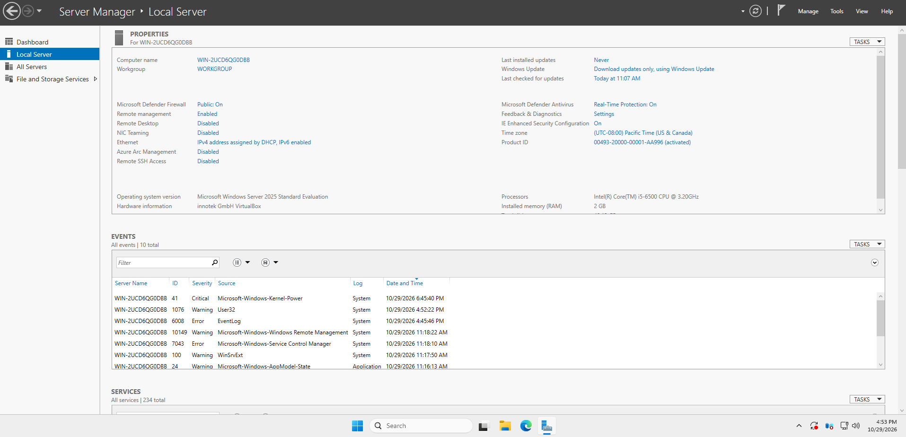
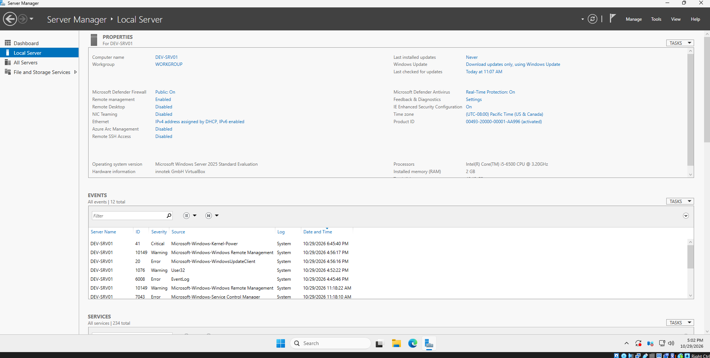
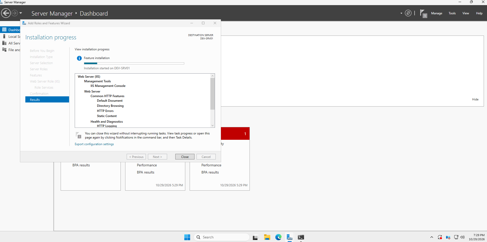
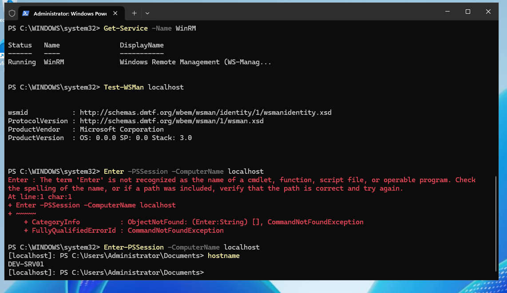
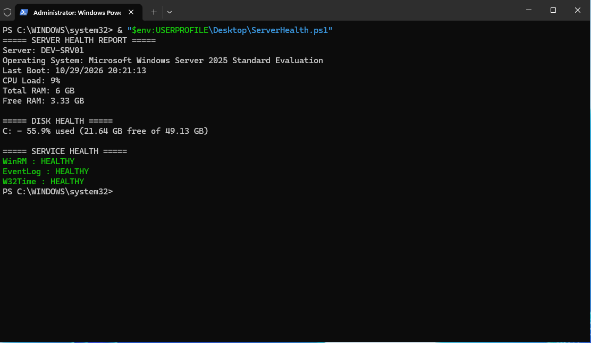

# Windows Server 2025 Administration
## Lab 01: Server Deployment, Remote Management & Health Monitoring

### Overview

Windows Server administration involves more than getting an operating system installed. A properly managed server must be accessible, monitored, and maintained so administrators can identify problems before they become service interruptions.

In this hands-on lab, I deployed Windows Server 2025 Standard Evaluation in Oracle VirtualBox, configured the server environment, validated network connectivity, enabled PowerShell Remoting, and developed and tested a server health monitoring script.

The goal was to practice practical Windows Server administration tasks relevant to enterprise infrastructure support and Network Operations Center (NOC) environments.

### Lab Environment

| Component | Configuration |
|---|---|
| Hypervisor | Oracle VirtualBox |
| Operating System | Windows Server 2025 Standard Evaluation |
| Server Hostname | DEV-SRV01 |
| Memory | 6 GB |
| Virtual CPUs | 2 |
| Network | VirtualBox NAT |
| IP Assignment | DHCP |
| Server Role | Standalone workgroup server |
| Administration | PowerShell, Server Manager, Windows Remote Management |

### Initial Server Deployment

I began with a fresh Windows Server 2025 installation and established a baseline for the development environment.

The server was deployed as a virtual machine to provide an isolated environment for testing administrative procedures without affecting production systems.



After installation, I configured the server identity as `DEV-SRV01` and verified the operating system configuration.



The virtual machine initially had limited resources, which caused noticeable performance issues during administrative operations. I increased the allocation to 6 GB RAM and two virtual processors to provide a more usable environment.

### Network Connectivity and Troubleshooting

Before proceeding with server administration, I verified that the virtual machine had functioning network connectivity.

The server received its address through DHCP using VirtualBox NAT networking. Connectivity testing included reaching an external IP address and verifying DNS resolution.

These checks helped distinguish basic network connectivity from name-resolution problems.

### Windows Server Role Management

I explored Windows Server role deployment using Server Manager and PowerShell, including initiating installation of the Web Server (IIS) role.



This exercise provided experience working with the Windows Server feature installation process and managing operations that require a restart.

I did not include a completed IIS application deployment in this lab, so the screenshot documents the installation process rather than a verified running web service.

### Windows Remote Management and PowerShell Remoting

Windows Remote Management (WinRM) provides the underlying management service used by Windows PowerShell Remoting.

I verified that WinRM was running and tested its responsiveness using `Test-WSMan`.

I then established a PowerShell session targeting the local server:

```powershell
Enter-PSSession -ComputerName localhost
```

Inside the session, I executed commands to confirm that the session was operational and that the server identified itself as `DEV-SRV01`.



This validated PowerShell Remoting against the local host. A cross-machine remote administration connection was not part of this lab.

### Server Health Monitoring

The primary administrative exercise involved creating a reusable PowerShell health monitoring script.

The script collected several categories of server information through Windows Management Instrumentation (WMI/CIM) and PowerShell service-management commands.

**Operating system and resource monitoring**

The health report retrieved the server hostname, operating system, last boot time, CPU utilization, total system memory, and available memory.

**Disk monitoring**

Using `Win32_LogicalDisk`, the script examined fixed disks and calculated storage utilization as a percentage of total capacity.

This provides a practical way to identify servers approaching storage capacity limits.

**Windows service monitoring**

The script also checked the status of three Windows services:

- Windows Remote Management (`WinRM`)
- Windows Event Log (`EventLog`)
- Windows Time (`W32Time`)

Services that were running were reported as healthy. Missing or stopped services were displayed as alerts.

### Testing and Validation

Rather than relying exclusively on healthy results, I tested the script's behavior under different service conditions.

I temporarily added a stopped service and a nonexistent service name to the monitoring list to verify that the script could distinguish healthy, stopped, and missing services.

After confirming the alert behavior, I restored the monitoring configuration to its intended service list.

The final script produced a consolidated server health report containing operating system information, CPU and memory statistics, disk utilization, and service status.



### Operational Relevance

This lab reflects several activities commonly performed in Windows infrastructure support environments.

Resource monitoring helps technicians investigate performance complaints and identify capacity issues. Service checks help isolate failures affecting system functionality, while PowerShell provides a foundation for repeatable administration and diagnostic tasks.

The completed health report demonstrates how routine administrative checks can be combined into a single troubleshooting tool rather than performed individually each time.

### Key Takeaways

The most valuable part of this lab was developing and validating the health monitoring workflow, including testing its handling of stopped and missing services.

The lab also reinforced practical Windows Server management concepts, troubleshooting VM performance limitations, validating connectivity, and working with PowerShell Remoting.

**Lab status: Completed**

**Next lab:** Active Directory Domain Services and Group Policy administration.
